# Architecture

Briefcut is a video editor that runs on Meta's models and renders on your own computer. The design rests on one rule: **the model proposes, the compiler executes.** Meta's models watch, listen, and judge, and they answer only in bounded JSON. Deterministic code checks every answer, places it on one clock, and compiles it into an FFmpeg program that you can read and run again. Each version ships with receipts that say how each claim is known.

This page shows the whole system in diagrams. Each diagram names the real files and functions, so you can check it against the code. The why is in [docs/WHY.md](docs/WHY.md). The editor's detailed contract (routes, patch ops, cutout internals, the Studio editor API) is in [docs/EDITOR_ARCHITECTURE.md](docs/EDITOR_ARCHITECTURE.md).

## Contents

1. [System context](#1-system-context)
2. [One project, end to end](#2-one-project-end-to-end)
3. [The model proposes, the compiler executes](#3-the-model-proposes-the-compiler-executes)
4. [One clock](#4-one-clock)
5. [Receipts and evidence labels](#5-receipts-and-evidence-labels)
6. [A job's lifecycle](#6-a-jobs-lifecycle)
7. [Meta calls and money](#7-meta-calls-and-money)
8. [Feature pipelines](#8-feature-pipelines)
9. [The agent surface](#9-the-agent-surface)
10. [The brief compiler underneath](#10-the-brief-compiler-underneath)
11. [Code map](#11-code-map)
12. [Invariants](#12-invariants)

## 1. System context

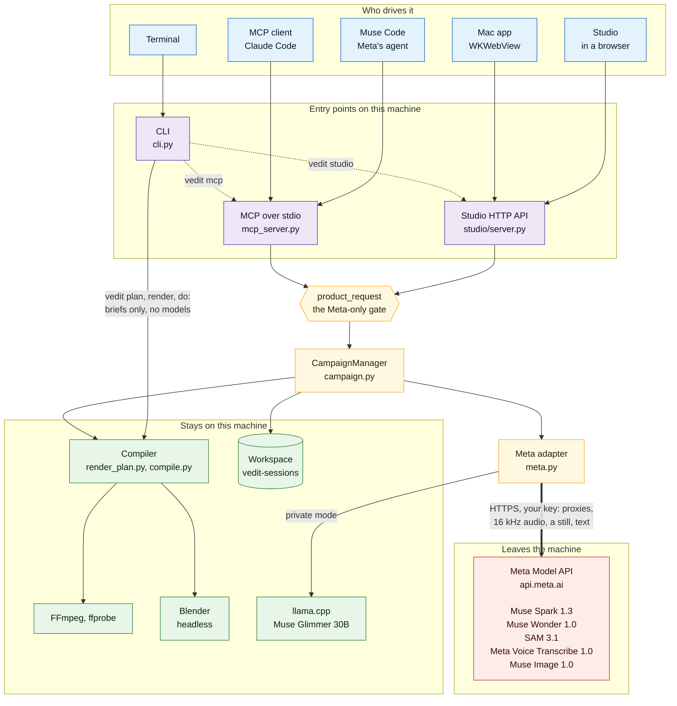

**Why it is built this way.** There is one product core, `CampaignManager`, and three doors into it. Studio, the Mac app, Muse Code, and any MCP client all reach the same manager, the same job database, and the same receipts, so a person and an agent can work on the same project. Every new project passes through `product_request` (`campaign.py`), which fills in Meta and refuses `provider="local"`; the model-free path survives only for the test suite. Only `meta.py` talks to anything beyond this machine, and only to `api.meta.ai` (redirects are refused, so the key cannot be forwarded). The red box is the only thing outside the machine. Your original files never go there: Meta gets a 960x540 or 540x960 analysis proxy, a mono 16 kHz WAV, a 540p review copy, one still for a cover, or text, as [docs/PRIVACY.md](docs/PRIVACY.md) lists per feature. Rendering, Blender, and private-mode Muse Glimmer all run here. The CLI's brief commands (`vedit plan`, `render`, `do`) drive the compiler directly and call no model.

## 2. One project, end to end

One project runs as a durable job. The first diagram goes from the upload to an editable plan. The second goes from approval to version N+1.

### 2a. From upload to an editable plan

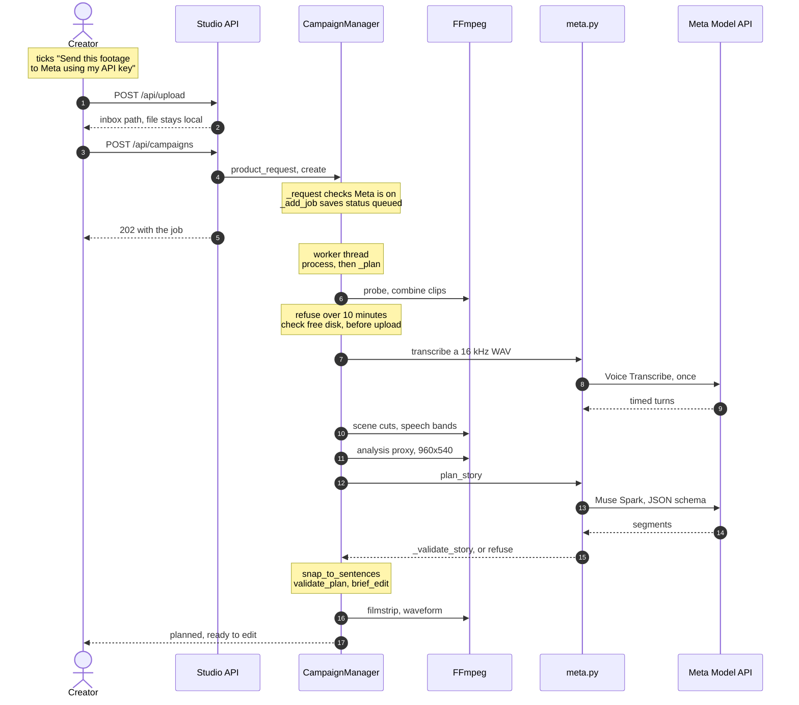

### 2b. From approval to version N+1

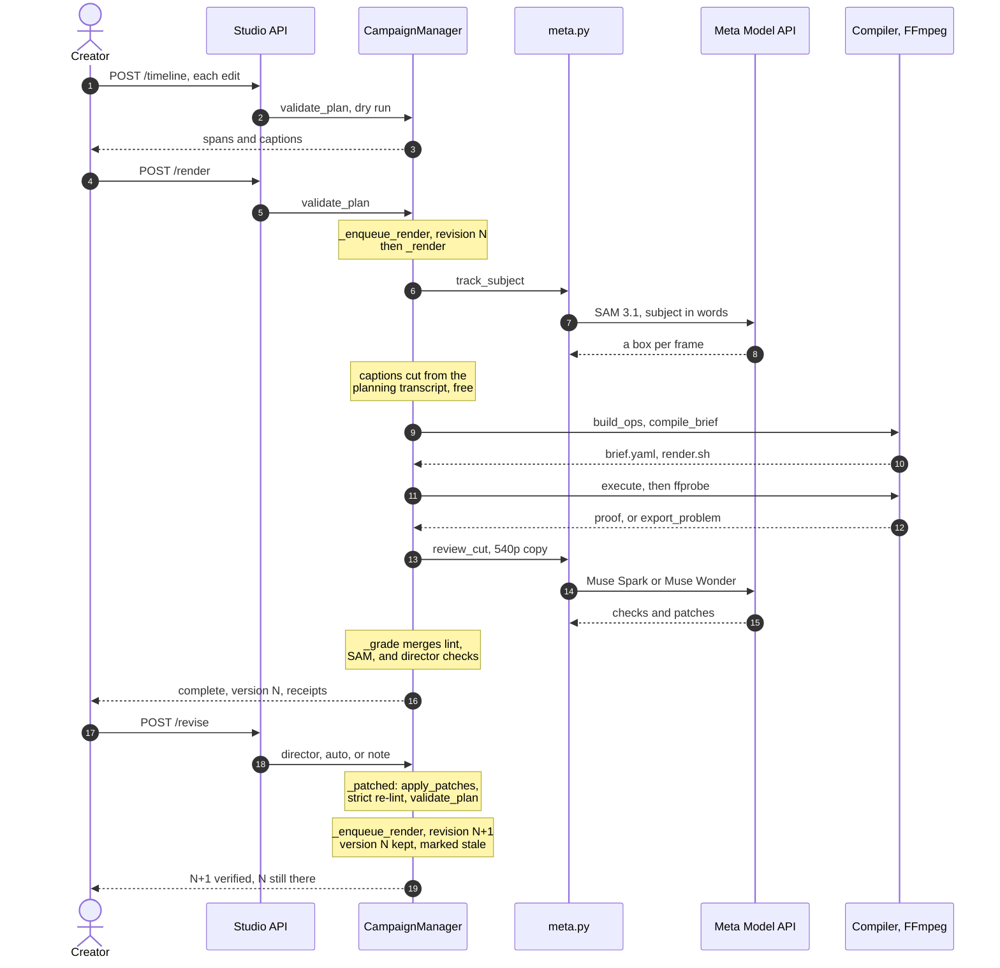

**Why it is built this way.** The expensive, uncertain work happens once and is cached. Voice Transcribe hears the project once in `_hear`, and the planner, the lint, find, and the captions all read that one transcript; a short reuses its parent's. The 10-minute limit and free disk are checked before anything is uploaded, so a project that cannot finish costs nothing. The plan is data the person edits; `POST /timeline` returns the server's own spans and captions for every draft, so the preview never guesses. Tracking runs at render time on a proxy that the render's own `select_ranges` assembled, so frame N of SAM's answer is frame N of the finished video. The job is marked complete only after ffprobe reads the file and `export_problem` agrees with the request. The director's review comes after that, so a failed review is a warning and never touches a verified file. A revision is a new version: `_enqueue_render` keeps version N and its files until N+1 passes. If planning heard no speech, `_meta_captions` sends Voice Transcribe only the kept audio at render time instead.

## 3. The model proposes, the compiler executes

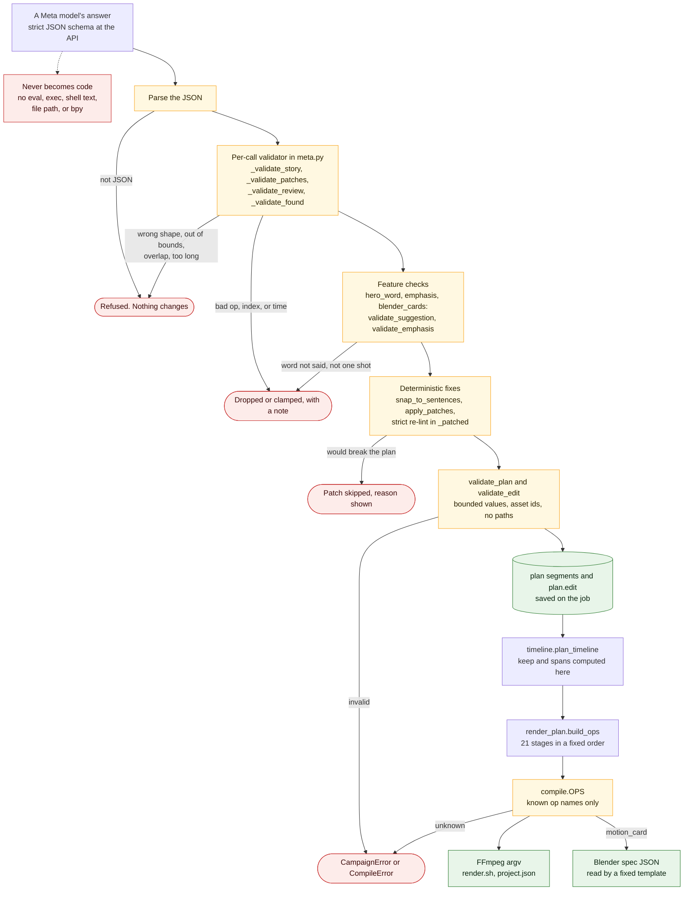

**Why it is built this way.** A JSON schema guarantees an answer parses. It does not guarantee the answer is right, safe, or affordable to render. So every answer passes through several gates, and each gate either accepts, clamps with a note, or refuses with a plain sentence. `_validate_story` refuses a story with overlapping moments, moments outside the source, or more than the target length. `_validate_patches` drops any op outside `PATCH_OPS`, any moment number that does not exist, and any time outside the source. `apply_patches` (`lint.py`) never raises; a patch that would break the plan comes back with `skipped` set. `_patched` then re-runs the lint strictly and applies its own fixes last, so a model's cut that lands inside a sentence is snapped back to a boundary. `validate_plan` (`campaign.py`) takes `analysis` and `provider` from the trusted original, never from the client, and `keep` is always computed. Only then does `render_plan.build_ops` emit ops, and `compile.py` looks each one up in `OPS`; an unknown name is a `CompileError`. Blender gets a JSON spec and a fixed template (`assets/blender/motion_card.py`) that reads it with `json.load`, looks every choice up in closed tables, and only ever sets the words as a text body.

## 4. One clock

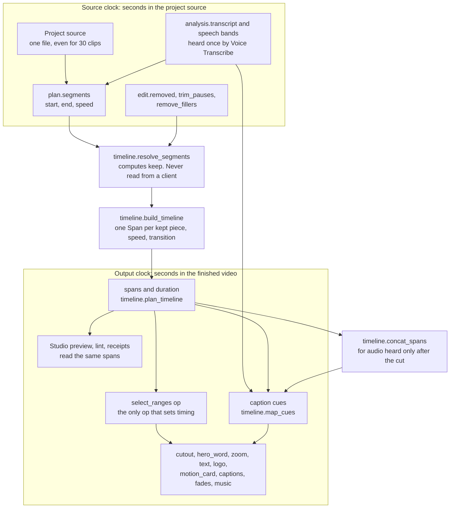

**Why it is built this way.** Every edit that changes time (a trim, a removed pause, a filler, a speed change, a transition) is decided before the render, in one pure module, `src/vedit/timeline.py`. It touches no file and no process. The compiler, the captions, the lint, the preview, and the receipts all read its spans, so a cut can never disagree with its own captions. `select_ranges` applies `keep`, `speed`, and the transition in one step. Every op after it works on the output clock, and none of them may change timing; a window for a hero word or a motion card is placed on the output clock and moves nothing. When Voice Transcribe hears only the kept audio at render time, `concat_spans` maps what it heard back through the same spans.

## 5. Receipts and evidence labels

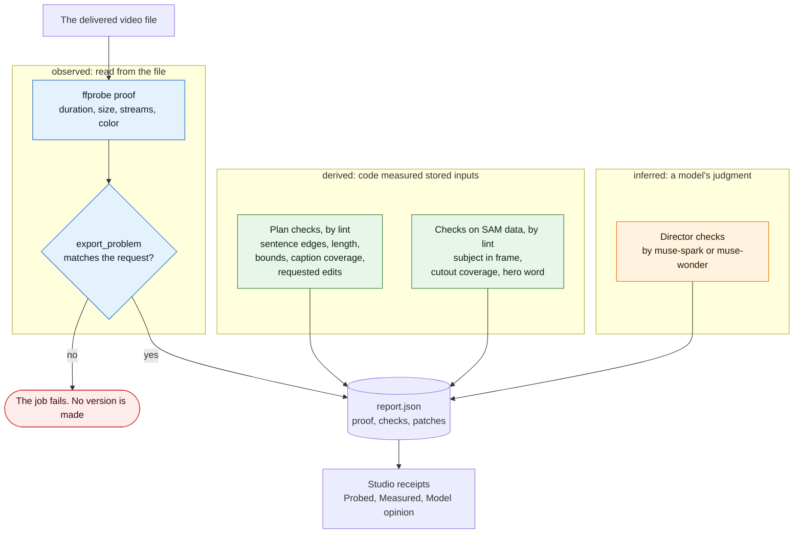

**Why it is built this way.** A receipt is only useful if it says how it knows. Every check is a record `{name, passed, at, note, basis, by, inputs?}` (`lint.py`). `basis` is one of three words, strongest first, borrowed from the REA project's evidence model (`lint.BASES`): **observed** is read straight from the delivered file, **derived** is code measuring the cut against stored inputs, and **inferred** is a model's opinion. `by` names the instrument, and `inputs` names any model whose data a measurement read, so "SAM masked 100% of 60 frames" is a measurement of SAM's data, not SAM's say-so. `CampaignManager._grade` builds the list; the director's checks are always `inferred`. Find returns its own receipt in the same shape, `by: sam-3.1` with `inputs: ["muse-spark"]`, beside the moments it checked. `at` is a time on the output clock, so Studio's receipts jump straight to the moment. Studio (`studio.js`) shows each check with a tag: Probed, Measured, or Model opinion with the model's name. Patches from the lint are marked `auto` and patches from the review `director`, which is what "Apply automatic fixes" and "Apply director's fixes" act on.

### Receipts you can verify

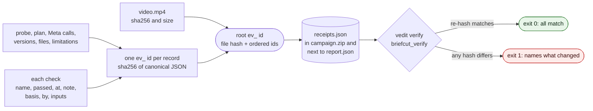

**Why it is built this way.** A label says how a check knows. It does not stop anyone from editing the check later. So every render also writes `receipts.json` (`evidence.py`), the idea taken from REA's evidence model (MIT). Each record gets an id: `ev_` plus the sha256 of its canonical JSON (sorted keys, no whitespace, NFC text, floats rounded to 6 places). The records are each check, the ffprobe proof with its streams and color, the plan's edit and segment hashes with the revision note, the Meta calls from `meta/meta-calls.jsonl` (model, purpose, cost, response id), the versions, the other bundle files, and a list of limitations. One root id covers the video's sha256 and every record id, in order. `vedit verify` takes the zip, a project folder, or `receipts.json`. It re-hashes the video, each file and each record, makes no network call, and names the exact item that changed. `briefcut_verify(job_id)` does the same over MCP and also compares the root with the one the job stored at render time. Studio shows that root under File verification with a copy button. The ids are hashes, not a signature. Someone who edits a record and recomputes every id makes a new, consistent file. Only a root id from a trusted place (`vedit verify --expect ev_...`) rules that out.

## 6. A job's lifecycle

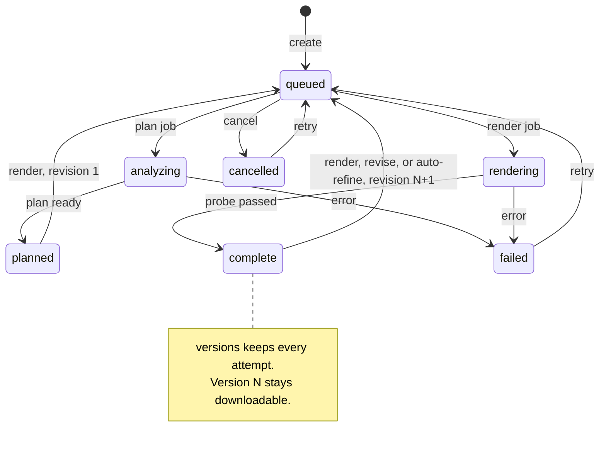

**Why it is built this way.** Jobs live in SQLite (`campaigns.sqlite3`, WAL mode) and run on one worker thread, so closing the browser does not stop them. The statuses in the code are `queued`, `analyzing`, `planned`, `rendering`, `complete`, `failed`, and `cancelled`. Planning is a set of stages inside `analyzing`: reading, combining, transcribing, measuring, preparing, planning, and timeline. Cancel stops a queued or planned job at once, and an analyzing or rendering job at its next `_check_cancel`. Revising is not its own status: `revise` and auto-refine queue the same job again as revision N+1 with `_enqueue_render`, and the verified result stays on the job, marked `stale`, until the new render passes. A failed render is appended to `versions` so the history shows which attempt broke. An auto-refine round that fails or is cancelled puts the job back on its last verified version (`_restore_verified`). If Studio stops mid-job, the next start marks active jobs `failed` with stage `interrupted`, and Retry continues from the saved plan. A file lock on the workspace (`.worker.lock`) lets only one process run jobs at a time.

## 7. Meta calls and money

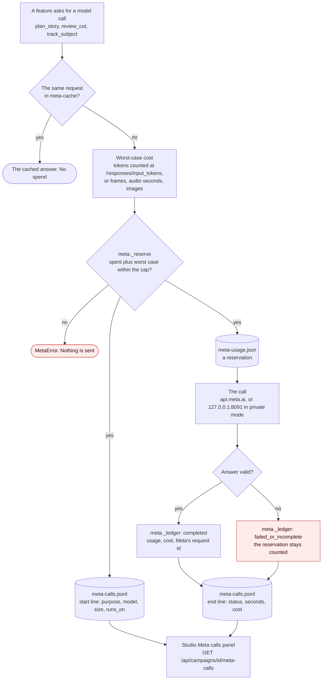

**Why it is built this way.** Money is checked before it is spent, not after. Every paid call path in `meta.py` (story, review, patch, find, shorts, script, translate, emphasis, motion card, tracking, masks, transcribe, image, cover) calls `_reserve` with its worst case. For Muse Spark and Muse Wonder that is the counted input tokens plus the full 16,384-token output allowance; for SAM it is frames, for Voice Transcribe audio seconds, for Muse Image one picture. `_reserve` sums every earlier call at the larger of its reservation and its actual cost, and refuses if the new worst case would cross the project cap ($0.25 by default, $5 at most). A refused call sends nothing. A call that times out or returns bad JSON keeps its reservation, so retries can never reset the allowance. A Wonder review is checked twice by `_review_affordable`, once before the upload, so a budget that cannot cover it never sends the video. `_reserve` and `_ledger` also write the append-only call log, `meta-calls.jsonl`: purpose, model, sizes, cost, seconds, and Meta's request id, never the key, prompts, transcripts, or media. `meta.call_log` reads it for Studio's Meta calls panel (`meta-calls.js`). Each row carries `runs_on`: `meta-api`, or `local` with the llama.cpp build and GGUF file for private mode, at $0.

## 8. Feature pipelines

Each feature follows the same shape: a Meta model proposes data, code checks it, and the compiler draws it. Where two models touch the same claim, one checks the other.

### 8a. Hero word behind the subject

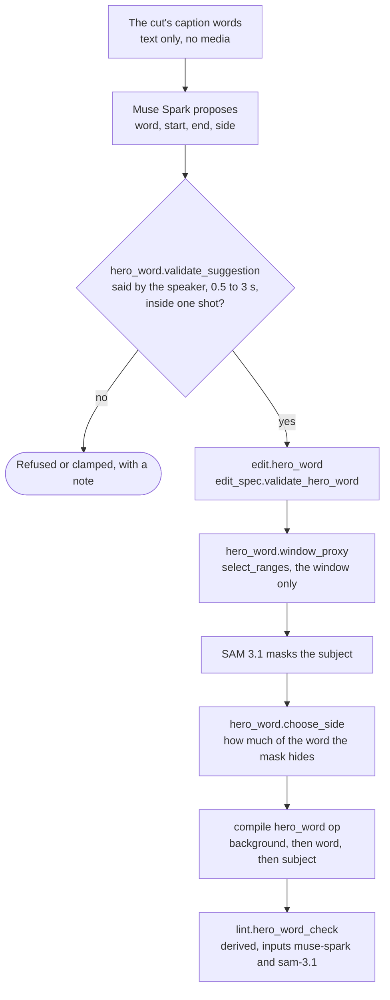

Spark picks a word; SAM's mask decides where it can be read. In the [live proof](docs/evidence/hero-word/README.md), Spark chose "center", where the bowl would have covered 82% of the word. `choose_side` moved it to "top", where it covers 20%. SAM is billed only for the window: 60 frames, $0.012.

### 8b. Verified find

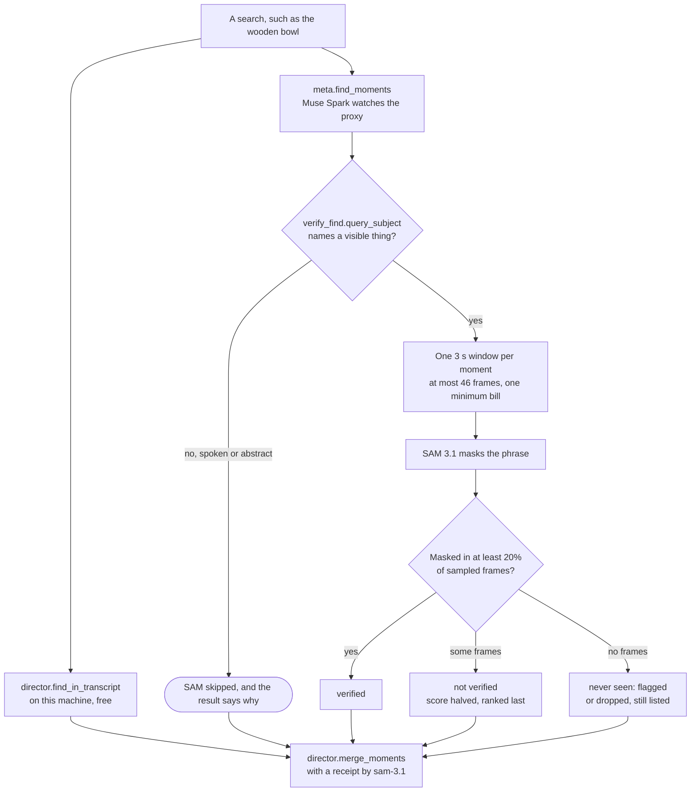

A schema makes Spark's answer parse. SAM checks it against pixels. The default is flag, not drop, because SAM can miss: in the [live proof](docs/evidence/verified-find/README.md) Spark correctly found a stylised gouge that SAM could not see under two names and two resolutions, and the flag kept that right answer in view.

### 8c. Punch words in captions

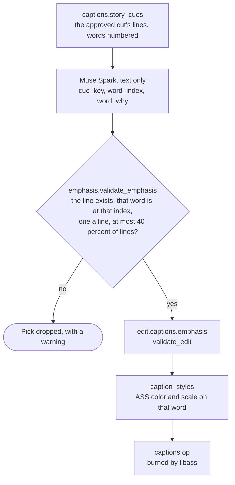

Nothing is uploaded; only caption text is sent. A pick must name a real line and the word really at that place in it. [Live proof](docs/evidence/caption-emphasis/README.md): two picks on six lines, $0.0004.

### 8d. 3D motion card

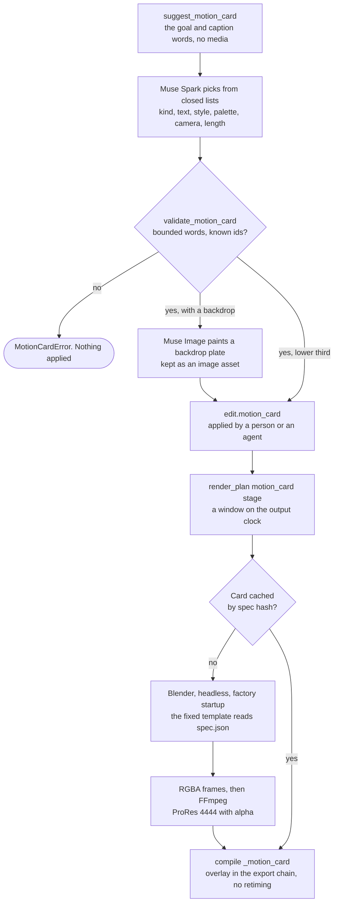

Spark designs, but never writes code. The template `assets/blender/motion_card.py` reads the spec with `json.load`, picks rows from its own tables, and sets the words as a text body. [Live proof](docs/evidence/blender-cards/README.md): a 3 s intro card, 90 frames in 24 s of Blender, $0.0104 for Spark and Muse Image, and a cache hit on the second render.

### 8e. Director review with Muse Spark or Muse Wonder

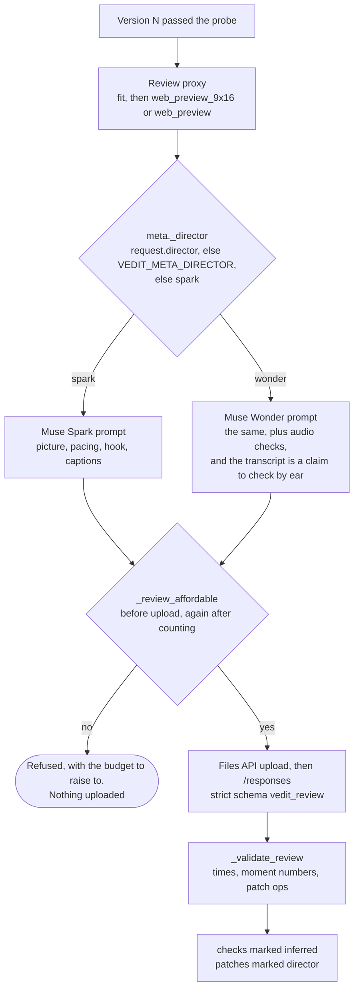

The director sees what a viewer sees: a vertical cut is reviewed vertical, at 540x960. Wonder gets the same upload and schema as Spark, plus audio checks. In the [live comparison](docs/evidence/wonder-review/README.md), Wonder failed two checks that the frames confirm and Spark passed, and only Wonder described the soundtrack truthfully. It cost $0.1010 against Spark's $0.0018, so Spark stays the default.

### 8f. Private mode: Muse Glimmer on this machine

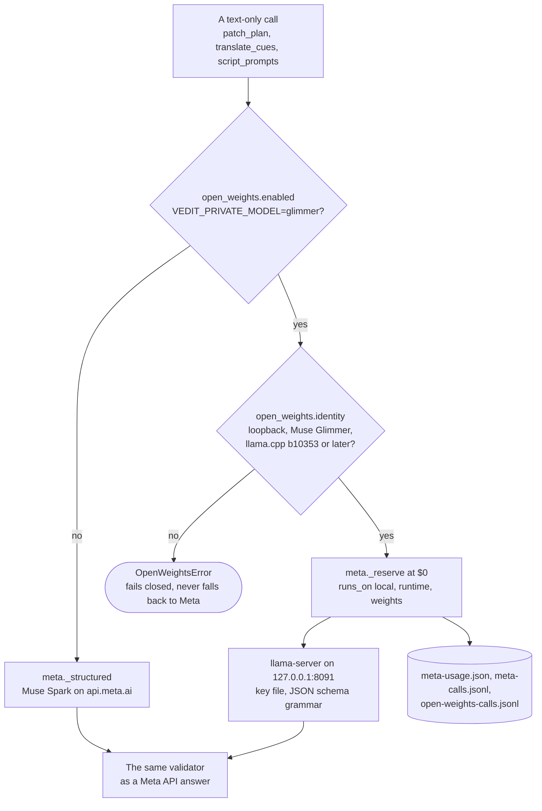

Only the model call moves. The callers in `meta.py` keep their prompts, schemas, validators, and caches, and the call goes through the same ledger and call log at $0. Video, SAM, Voice Transcribe, and Muse Image still need the Meta API. [Live proof](docs/evidence/open-weights/README.md): five calls ran with `meta._request` replaced by a function that fails the run, so nothing could reach the Meta API.

## 9. The agent surface

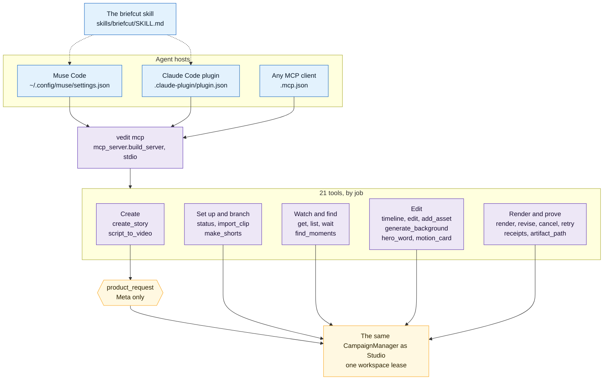

**Why it is built this way.** An agent gets the same editor a person gets, not a separate API. `vedit mcp` runs the process-wide `CampaignManager` from `get_manager()`, so projects an agent makes open in Studio, and the other way round. Tool names above drop the `briefcut_` prefix for space. The two tools that create a project (`briefcut_create_story`, `briefcut_script_to_video`) pass `product_request` first, so a local request is refused before the manager opens. Edits follow Studio's rule: `briefcut_edit` builds a draft from the saved plan, and only the manager validates it, as a dry run unless `render` is true. `briefcut_hero_word` and `briefcut_motion_card` return a checked suggestion and change nothing. `briefcut_receipts` returns the checks, the probe, the patches, and the version history, which is the proof an agent should report. The skill tells an agent when and how to use the tools; the Claude Code plugin ships both the skill and the server, and Muse Code finds the same skill through the `.agents/skills/briefcut` link ([docs/MUSE_CODE.md](docs/MUSE_CODE.md)). The recorded Muse Code run ([evidence](docs/evidence/muse-code/README.md)) exercised `briefcut_import_clip`; a full agent-driven edit is not yet recorded there.

## 10. The brief compiler underneath

Studio and the agents end in the same place the CLI starts: a `Brief` (`ir.py`) of named sources and ops. `compile.compile_brief` walks the ops on a **tape**, the current clip plus pending video and audio filters. Ops that only add filters (`color`, `fit`, `fade_in`, `look`) accumulate. Ops that need a real file (`select_ranges`, `captions`, `music`, `loudnorm`, `export`) flush the tape into one step. `pipeline.write_codegen` writes `project.json` and `render.sh` before the first encode, and `pipeline.execute` runs each step and keeps its argv and stderr. `render.sh` and `brief.yaml` are a complete record: a delivered edit can be re-run without Briefcut. `timeline.otio.json` is interchange, not the program. The engine follows the open-source tools that last: [MLT](https://www.mltframework.org/) and Shotcut or Kdenlive (tractor and playlist), [OpenTimelineIO](https://opentimeline.io/) (interchange), [editly](https://github.com/mifi/editly) (JSON to FFmpeg), and [auto-editor](https://github.com/WyattBlue/auto-editor) (silence-first cutting). Briefcut takes the IR and code generation idea and makes the program the product.

## 11. Code map

| Area | Files |
| --- | --- |
| Entry points | `studio/server.py` (HTTP), `mcp_server.py` (MCP), `cli.py`, `macos/VeditApp.swift` |
| Product core | `campaign.py`: `product_request`, `CampaignManager` (`create`, `_plan`, `render`, `_render`, `revise`, `find`, `shorts`, `_grade`, `suggest_hero_word`, `suggest_motion_card`) |
| Every Meta call | `meta.py`: `plan_story`, `review_cut`, `patch_plan`, `find_moments`, `plan_shorts`, `script_prompts`, `translate_cues`, `track_subject`, `subject_masks`, `transcribe_audio`, `generate_image`, `generate_cover`, `_reserve`, `_ledger`, `call_log` |
| Private mode | `open_weights.py` |
| One clock | `timeline.py` |
| Bounded edit data | `edit_spec.py`, `brief_ops.py`, `director.py` |
| Checks and patches | `lint.py` |
| Tamper-evident receipts | `evidence.py` (`canonical`, `evidence_id`, `bundle_receipts`, `verify`) |
| Compile and render | `render_plan.py` (`STAGES`), `compile.py` (`OPS`), `pipeline.py`, `media.py` |
| Captions | `captions.py`, `caption_styles.py`, `emphasis.py` |
| SAM features | `matte.py`, `hero_word.py`, `verify_find.py` |
| Motion cards | `blender_cards.py`, `assets/blender/motion_card.py` |
| Multi-clip projects | `project_media.py` |
| Studio | `studio/static/`: `studio.js`, `timeline.js`, `preview.js`, `inspector.js`, `mediabin.js`, `meta-calls.js` |
| Agent packaging | `skills/briefcut/`, `.claude-plugin/plugin.json`, `.mcp.json`, `.agents/skills/briefcut` |

## 12. Invariants

- Models return data. `validate_plan`, `validate_edit`, and `apply_patches` decide what is accepted. No model output is run as code.
- One clock. All timing goes through `timeline.py`, and nothing after `select_ranges` changes it.
- A version is verified only after ffprobe reads the delivered file. A review never changes a verified file.
- A revision never replaces a file. Version N stays until N+1 passes, and after.
- Every paid call reserves its worst case first and stays on the ledger, so the cap holds across retries.
- Only `meta.py` reaches beyond this machine, and only `api.meta.ai`. Private mode talks only to 127.0.0.1 and never falls back.
- A feature that cannot run on this machine says so through `capabilities()` and is not offered.
