<p></p>

# Briefcut by Aubric, Inc.

Turn your footage into a story worth watching. Briefcut is a video editor built on Meta's models. Muse Spark watches your clips and proposes the story. SAM 3.1 follows the subject. Meta Voice Transcribe writes the transcript and captions. Muse Image makes the cover. Muse Wonder can watch and hear the finished cut as a senior director, and Muse Glimmer, Meta's open-weight model, can run the text steps on your own computer. You correct the plan, and FFmpeg renders the video on your own computer. Every version ships with receipts: a probe of the delivered file and the checks it passed or failed.

## See it

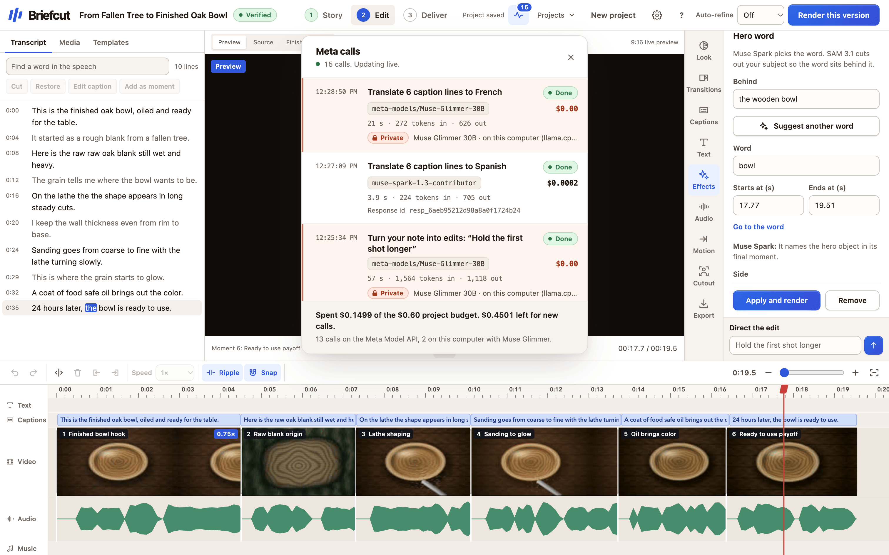

The Edit step on a finished project. Muse Spark picked the hero word and says why. The Meta calls panel lists every call and what it cost.

<table>
  <tr>
    <td width="33%" valign="top">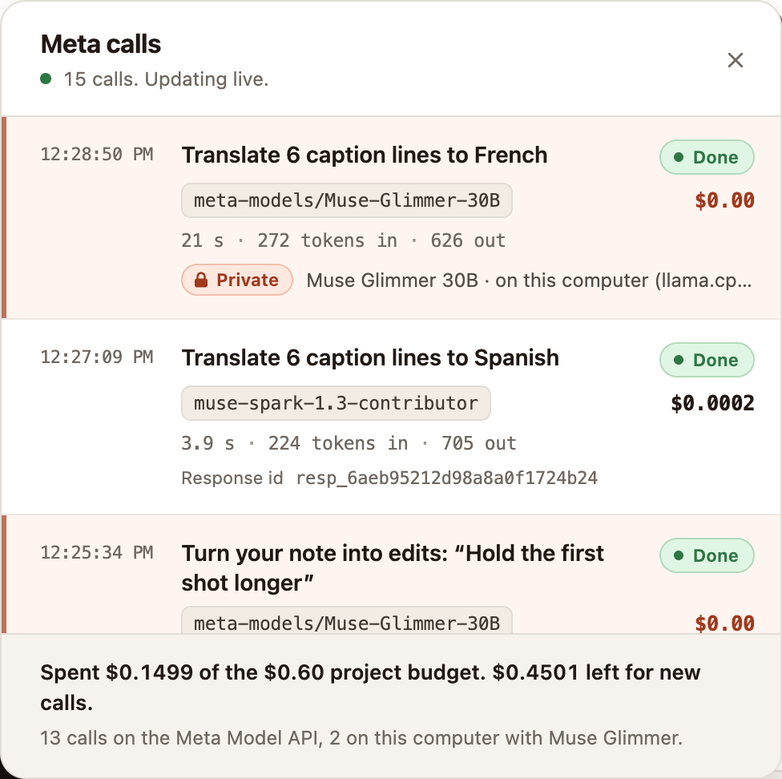</td>
    <td width="33%" valign="top">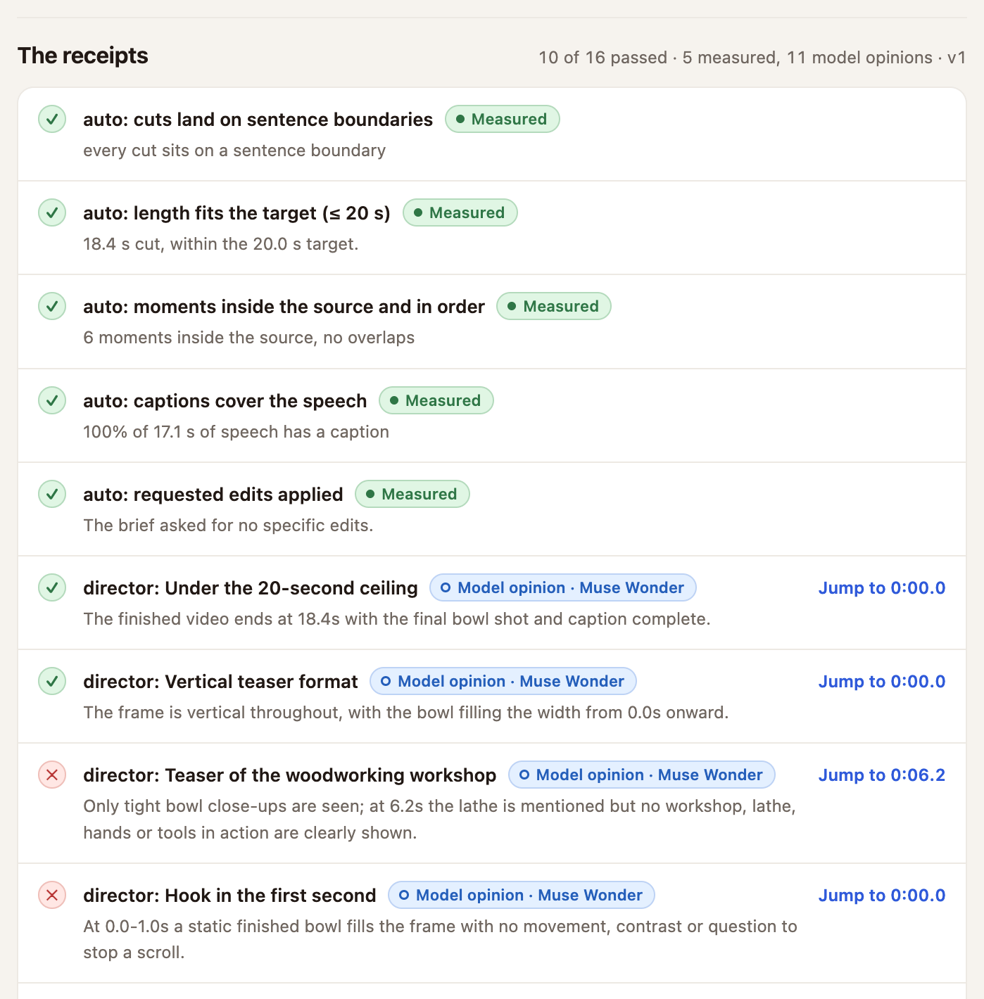</td>
    <td width="33%" valign="top"></td>
  </tr>
  <tr>
    <td valign="top">Every Meta call, with its model, tokens and cost. Private calls run on this computer.</td>
    <td valign="top">Each receipt says how it is known: measured by code, or a model's opinion.</td>
    <td valign="top">A hero word in a render. SAM 3.1 cuts out the bowl, so the word sits behind it.</td>
  </tr>
</table>

Briefcut is a product of Aubric, Inc. The Python package and CLI are called `vedit`; `vedit` and `briefcut` are the same tool.

## Why Briefcut

Video editors today are either manual timelines that cost hours, or AI black boxes you cannot check, script, or trust. Briefcut splits the job: Meta's models understand the footage and propose the edit as bounded data, and a deterministic compiler on your computer checks it and renders it with FFmpeg. Every version ships with receipts that say how each claim is known: probed from the file, measured by code, or a model's opinion. Meta's models check each other (SAM 3.1 verifies what Muse Spark finds), and any agent can drive the same editor over MCP, including Meta's own Muse Code. [docs/WHY.md](docs/WHY.md) gives the reasoning and links each claim to its evidence.

**Measured on real and public footage:** a verified short took 24 s to 2.5 minutes from raw clip to probed file, for $0.0005 to $0.08 of Meta usage per project. Tracking a subject with SAM 3.1 is the costliest step. A Muse Wonder review adds about $0.10. Meta Voice Transcribe hears 25 languages, by Meta's docs; Briefcut's captions were checked burning 17 languages and scripts, including Japanese, Arabic, Hebrew, Hindi and Thai. Every run, including the bugs it found, is in [docs/evidence/scenario-matrix](docs/evidence/scenario-matrix/README.md).

## Who it is for

- **Creators with phone footage and no time.** Say the story you want in one sentence. Briefcut plans, captions, reframes, and renders it, and you can see and fix every cut. In the [scenario matrix](docs/evidence/scenario-matrix/README.md), live runs took 24 s to 2.5 minutes from raw clip to probed file, and rotated, HDR, and variable-frame-rate iPhone clips and HEIC photos planned and rendered (with Meta stubbed).
- **Small businesses and teams making product or process videos.** Phrases in the brief such as "trim the pauses", "add a title card", `hook:` and `cta:` become edits. A second person can read the receipts before anything is posted. There is no seat license: each project costs cents on the team's own Meta key ([What it costs](#what-it-costs)).
- **Educators and podcasters turning long recordings into clips and shorts.** A project holds up to 2 hours of footage (`MAX_SOURCE_SECONDS` in [`project_media.py`](src/vedit/project_media.py)). Long-form planning watches it in parts of 10 minutes or less, then picks the story, or several shorts, across the whole recording. Live, it cut Tears of Steel, a 12-minute film, into a 44 s trailer and three shorts for $0.34 ([Long videos](#long-videos-why-a-long-view-matters)).
- **Developers and agents that need video as an API.** The same editor runs from MCP, an HTTP API, a CLI, or a YAML brief. Every edit compiles to a `render.sh` that re-runs with FFmpeg alone ([agent surface](ARCHITECTURE.md#9-the-agent-surface)).
- **People with private footage.** Your original files never leave your computer. Meta receives a small proxy, audio, a still, or text, and only after you confirm. Briefcut sends no analytics ([Privacy](docs/PRIVACY.md)). Private mode keeps the director's note, caption translation, and script scenes on Muse Glimmer, on your own computer.

## Why Briefcut instead of CapCut, Descript, Opus Clip or Premiere

Pick Briefcut when you need to check, script, or audit an edit, or keep your originals at home. Pick the others for libraries, mobile apps, and one-click publishing (see the list below the table).

| | Briefcut | A typical timeline editor (Premiere, CapCut) | A typical AI clip tool (Opus Clip, Descript) |
| --- | --- | --- | --- |
| You can check every claim | Yes. Each version carries a probe of the file and labeled checks, and `vedit verify` re-hashes them offline ([receipts](ARCHITECTURE.md#receipts-you-can-verify)) | No. You check by watching | No audit trail that we found. You get a draft, sometimes a score |
| Agents can drive it | Yes. One MCP server for any client, and Muse Code first ([recorded run](docs/evidence/muse-code/README.md)) | Varies. Scripting or plugins; CapCut describes a Codex workflow | Varies. Some offer an API |
| Open source | Yes, [MIT](LICENSE) | No | No |
| Renders on your own computer | Yes. Originals never leave. Meta gets proxies, audio, a still, or text, after you confirm ([Privacy](docs/PRIVACY.md)) | Yes, in the desktop apps | Usually no. You upload the video |
| Pay per use, no subscription | Yes, on your own Meta key. $0.0005 to $0.08 per project in the [scenario matrix](docs/evidence/scenario-matrix/README.md); SAM tracking and a Wonder review cost more | A subscription, or a free tier with paid extras | Monthly plans or credits, often with a free tier |
| Models check each other | Yes. SAM 3.1 checks what Muse Spark finds ([verified find](docs/evidence/verified-find/README.md)) | Not that we found | Not that we found |
| Multilingual | 25 spoken languages, detected automatically; captions translated; caption drawing tested in 17 languages and scripts ([tests](tests/test_robust_text.py)) | Yes, varies by product | Yes, varies by product |
| Private mode on open weights | Partly. Three text steps run on Muse Glimmer 30B on your computer ([private mode](#private-mode-muse-glimmer-on-your-computer)) | Not open weights, as far as we found | No. Cloud models |

The competitor columns come from the products' public pages, filled conservatively; "varies" means the products differ or we were not sure. Nothing here is a head-to-head quality test. [CAPCUT_PARITY.md](docs/CAPCUT_PARITY.md) has the feature-by-feature status against CapCut, with sources.

**Where others are still ahead:**

- **Templates and effects libraries.** Briefcut has 7 setting bundles, 10 transitions, and a few effects ([parity: editing](docs/CAPCUT_PARITY.md#editing)).
- **Stock media and music.** None is built. You bring your own music and images.
- **Mobile apps.** None. The web editor works at phone width.
- **Collaboration and cloud projects.** None. Projects stay on your computer by design.
- **AI video generation, avatars, and voice.** The Meta Model API has no video generation or text-to-speech model, so Briefcut has neither, and no avatars ([parity: AI features](docs/CAPCUT_PARITY.md#ai-features)).
- **Word-level transcript editing.** Voice Transcribe times turns, not words, so filler removal does nothing and word times are estimated. Descript is ahead here.
- **Direct publishing.** Downloads only ([parity: delivery](docs/CAPCUT_PARITY.md#delivery-and-platform)).
- **Maturity.** These products have years of polish and large user bases. Briefcut is new, and its records list the bugs it has found.

## Long videos: why a long view matters

Meta's docs give Muse Spark and Muse Wonder a 1,048,576-token context window ([models](https://dev.meta.ai/docs/models)), and Briefcut budgets each request to them against that ceiling (`_MAX_INPUT_TOKENS` in [`meta.py`](src/vedit/meta.py)). Video is heavy. Across ten live calls it added 156 to 265 billed tokens per second, so ten minutes of proxy video is about 94,000 to 159,000 tokens, and two hours would be 1.1 to 1.9 million, more than one request holds. Words are light. A two-hour talk at about 150 words a minute is about 18,000 words, or roughly 24,000 tokens: about 2% of one request (an estimate, not a measurement). Long-form planning is built on that difference.

- **Watch in parts, decide once.** Muse Spark logs candidate moments in each window of 10 minutes or less. Then one text-only editor call, by Muse Spark or Muse Wonder, reads the whole transcript and every window's candidates at once, and picks and orders the story across the full recording (`plan_candidates` and `edit_long_story` in [`meta.py`](src/vedit/meta.py)). A setup at minute 3 can pay off at minute 90, the editor can see that two windows make the same point and keep one, and the strongest moments win across the whole talk, not one per part.
- **Code still checks every pick.** A pick must be one of the candidates, by id, and its times come from the candidate, never from the model's answer. The usual sentence snap, clip snap, and plan checks follow. Before anything is sent, Briefcut estimates what every window will cost and refuses a source the project's budget cannot cover.
- **Wonder reviews the cut whole.** Muse Wonder watches and listens to the finished cut in one call (`meta.review_cut` with `director="wonder"`), so its notes cover the story from end to end ([Wonder review](docs/evidence/wonder-review/README.md)).
- **Long agent sessions stay checkable.** Meta describes Muse Spark 1.3 as tuned for long-horizon tasks, and Muse Wonder as built for long-horizon agentic work ([models](https://dev.meta.ai/docs/models)). Over MCP, Muse Code or any client can plan, find, check with SAM 3.1, edit, render, and verify in one session. Each tool returns checked data, so a mistake shows up at the step that made it. Muse Code ran a full edit this way on the demo clip: status, import, plan, render, receipts, and verify, in eight tool calls and about two minutes, for $0.03 of Briefcut's Meta spend ([record](docs/evidence/muse-code/README.md)).

**Measured live, standard mode:** Tears of Steel (12:14, 1920x800; (CC) Blender Foundation, mango.blender.org) went through Briefcut in 7.8 minutes for $0.34. Muse Spark read it in 2 parts and logged 24 candidate moments; the editor picked 5 for a 44.4 s trailer and left out the moments that give the ending away; three 9:16 shorts of 21 to 26 s followed from the same candidates. Every export passed 5 of 5 checks. The editor call read 3,208 tokens, 0.31% of the ceiling ([evidence](docs/evidence/long-form/README.md)).

## Why this grows Meta's model adoption

1. **Every project runs on Meta's models.** A project calls Muse Spark, Voice Transcribe when there is speech, and often SAM 3.1, Muse Image, or Muse Wonder, all through one adapter, [`meta.py`](src/vedit/meta.py). Usage grows with each video made, and the next video costs cents: $0.0005 to $0.08 per project in the [scenario matrix](docs/evidence/scenario-matrix/README.md), and $0.29 to $0.31 reserved for a two-version loop with SAM tracking ([What it costs](#what-it-costs)).
2. **Agents become a new channel for Meta's models.** One MCP server, [`mcp_server.py`](src/vedit/mcp_server.py), turns any agent into a video editor that runs on Meta's models, whatever model the agent itself uses. Muse Code is first, with its own skill and [a recorded run](docs/evidence/muse-code/README.md), and the same server is set up for Claude Code, Codex, Cursor, and Gemini CLI ([setup](#use-briefcut-from-any-mcp-agent)).
3. **Receipts let teams adopt model-made edits.** Each check says whether it was probed from the file, measured by code, or is a model's opinion, and `vedit verify` re-hashes the video and every record with no network call ([receipts](ARCHITECTURE.md#receipts-you-can-verify)). Teams that sign off on what they publish need that audit trail before they let a model edit for them.
4. **A reference design others can copy.** Muse Spark proposes, SAM 3.1 checks what Spark found ([`verify_find.py`](src/vedit/verify_find.py)), Muse Wonder reviews the cut by watching and listening ([Wonder review](docs/evidence/wonder-review/README.md)), and Muse Glimmer runs text steps locally. The code is MIT, so any developer can lift this pattern of models checking each other into their own product on Meta's stack.
5. **Open weights bring in privacy-bound users.** Private mode runs the director's note, caption translation, and the script writer on Muse Glimmer 30B on the user's computer, at $0, and fails closed ([`open_weights.py`](src/vedit/open_weights.py), [evidence](docs/evidence/open-weights/README.md)). It shows Meta's open model doing production work. Video planning and SAM still need the API, so this is a first step, not an offline editor.
6. **Global from the first project.** Voice Transcribe hears 25 languages and detects which one was spoken ([`meta.py`](src/vedit/meta.py)), and Muse Spark translates captions. Live records show Spanish and French captions and verified searches in Spanish and Chinese ([live integration](docs/evidence/live-integration/README.md), [robust features](docs/evidence/robust-features/README.md)).
7. **Spend you can see removes the fear of a runaway bill.** Each project has a cap ($0.25 by default, $5 at most), the adapter reserves an upper bound before each call, and Studio's Meta calls panel lists every call with its model, cost, and Meta's response id ([Meta calls and money](ARCHITECTURE.md#7-meta-calls-and-money), [screenshot](docs/evidence/open-weights/studio-meta-calls-light.png)). A developer can try Meta's models knowing the most a project can spend.

## Architecture

Every door into Briefcut reaches one project manager, `CampaignManager`. Only `meta.py` talks to Meta, and only what the red box receives leaves your computer: small proxies, 16 kHz audio, a still, or text, never your original files.

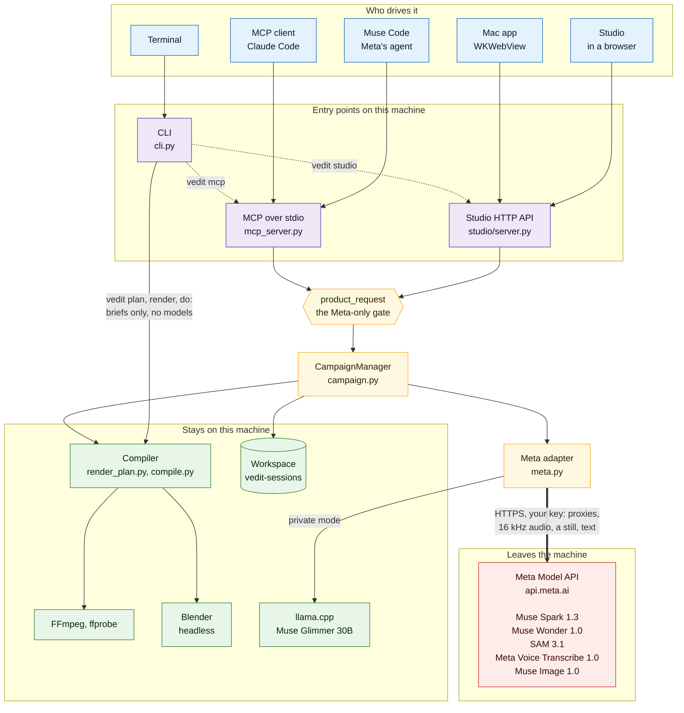

### One project, end to end

From the upload to an editable plan. Meta Voice Transcribe hears the project once, Muse Spark plans it, and code checks and snaps the plan before you see it ([details](ARCHITECTURE.md#2-one-project-end-to-end)).

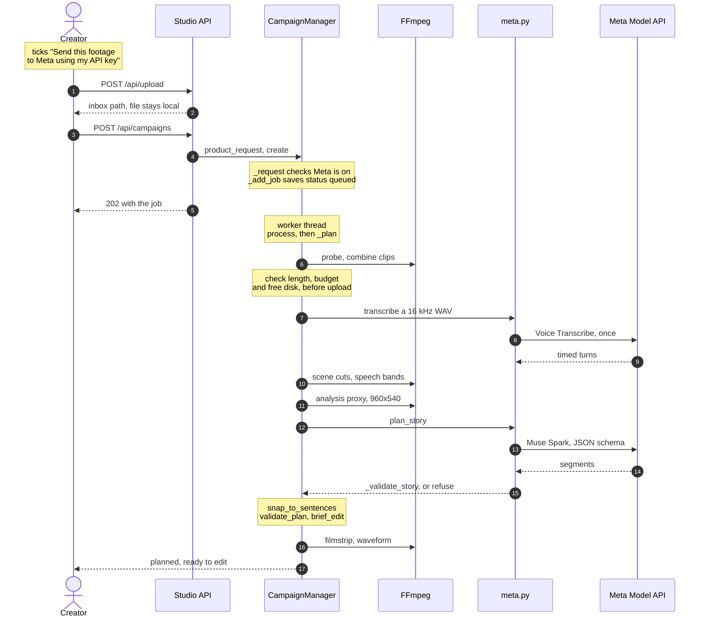

From your approval to the next version. The compiler renders, Briefcut probes the file, the director reviews it, and its fixes come back as data that make version N+1. Version N is kept.

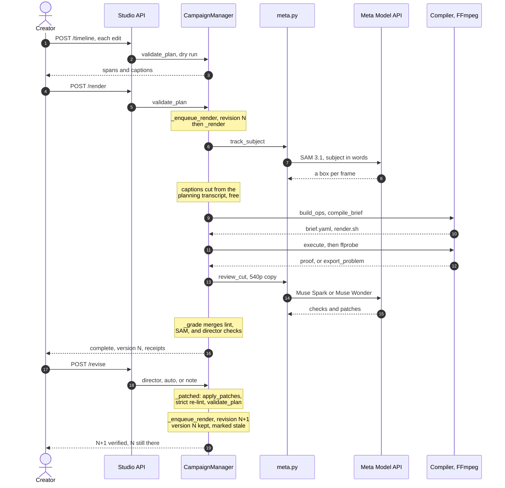

### The model proposes, the compiler executes

A model's answer is checked JSON, never code. Every value is validated, clamped, or refused before the compiler turns known op names into FFmpeg arguments ([details](ARCHITECTURE.md#3-the-model-proposes-the-compiler-executes)).

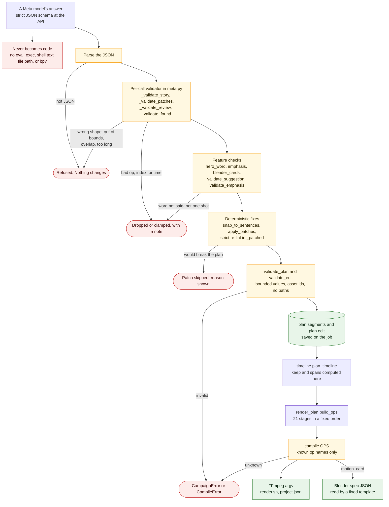

### Models check each other: the hero word

Muse Spark proposes the word, code checks that it was said inside one shot, and SAM 3.1's mask decides which side the word goes so the subject does not hide it ([all feature pipelines](ARCHITECTURE.md#8-feature-pipelines)).

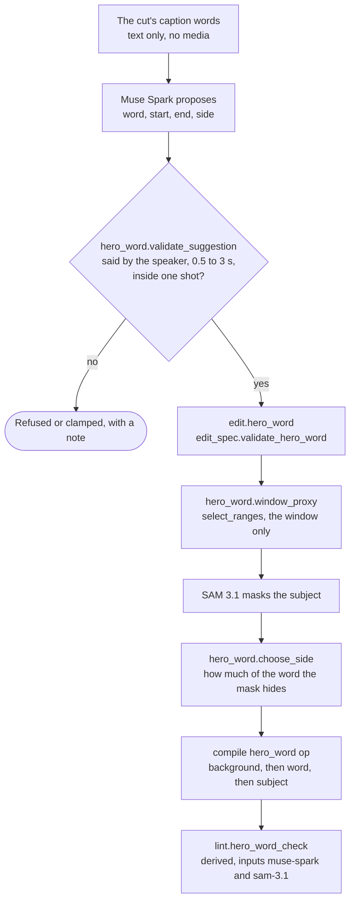

### Receipts and evidence labels

Every check says how it is known: observed from the file, derived by code, or inferred by a model. A file that does not match the request makes no version ([details](ARCHITECTURE.md#5-receipts-and-evidence-labels)).

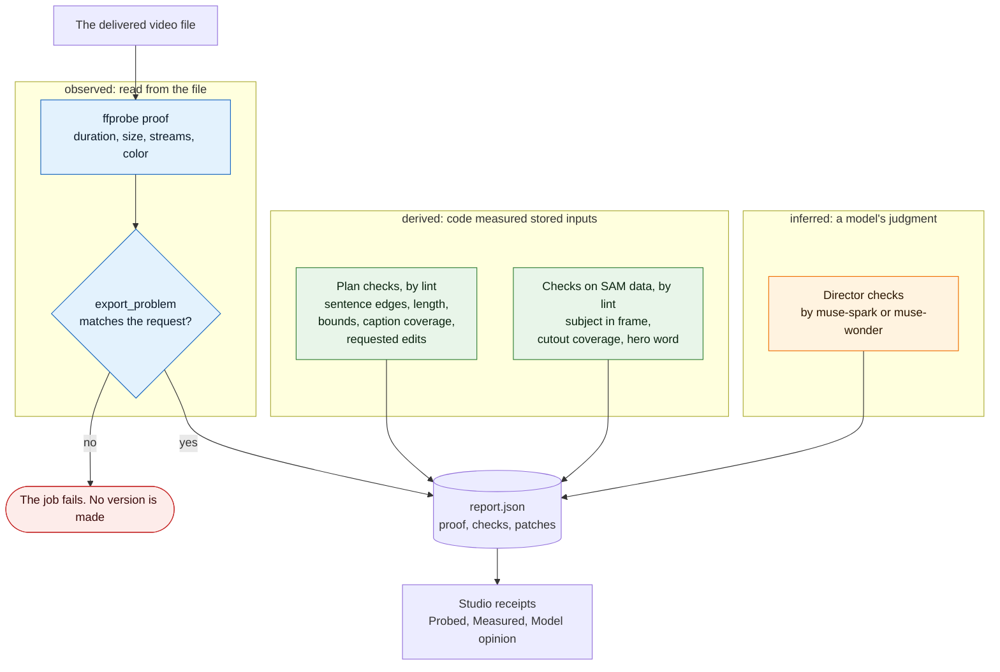

### Long videos

Muse Spark reads a long recording in parts, and one editor call with the whole transcript in view picks the story across all of it. Code still checks every pick ([why a long view matters](#long-videos-why-a-long-view-matters)).

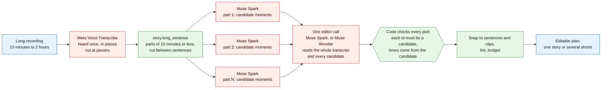

### Any agent can drive it

One MCP server with 22 tools, over the same `CampaignManager` Studio uses, so a person and an agent work on the same projects ([details](ARCHITECTURE.md#9-the-agent-surface), [Muse Code run](docs/evidence/muse-code/README.md)).

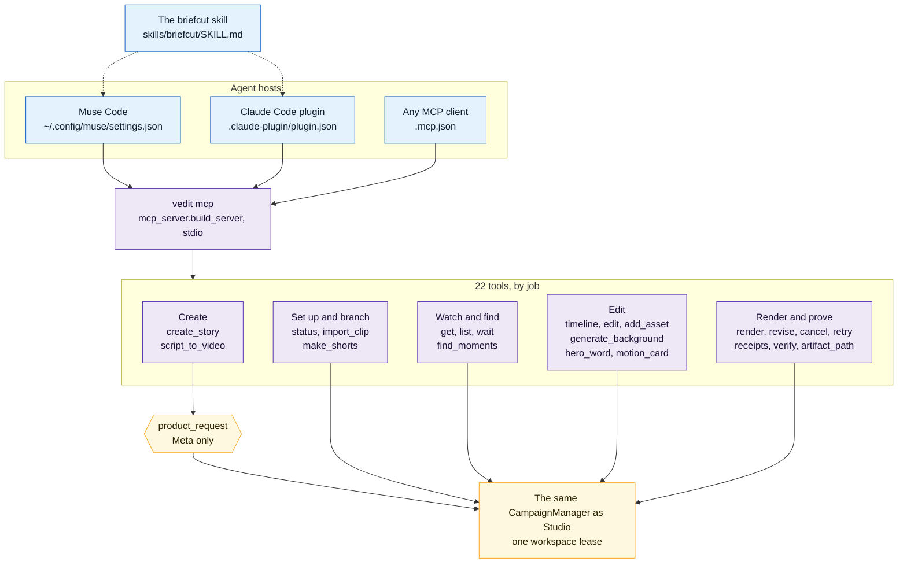

[ARCHITECTURE.md](ARCHITECTURE.md) has the full set of diagrams, each with the reason it is built that way: one project end to end, how a model's answer becomes FFmpeg steps without ever running as code, the one clock, receipts and their evidence labels, the job lifecycle, Meta spend, each feature pipeline, and the agent surface.

## Which Meta models Briefcut uses, and where each runs

Every model Briefcut calls is a Meta model, and every call goes through one adapter, [`src/vedit/meta.py`](src/vedit/meta.py). Calls go to the Meta Model API at `https://api.meta.ai/v1`, sent from your computer with your key. The one exception is private mode: three text-only steps can run on Muse Glimmer on your own computer instead. Models return data (ranges, boxes, cues, checks, patches). They never run code.

| Model | Model id in code | What it does in Briefcut | Where it runs | Source |
| --- | --- | --- | --- | --- |
| Muse Spark | `muse-spark-1.3`, or `muse-spark-1.3-contributor` in contributor mode | Plans the story from the footage and its transcript. Finds moments. Plans several shorts from one video. Turns a written script into scenes and picture prompts. Reviews the finished cut by default (Director's notes, checks, and patches). Turns a typed note into patches. Translates captions. Picks punch words for captions and the hero word. Designs 3D motion cards. | Meta Model API, called from this computer | `meta.py`: `plan_story`, `find_moments`, `plan_shorts`, `script_prompts`, `review_cut`, `patch_plan`, `translate_cues`; `emphasis.py`, `hero_word.py`, `blender_cards.py` |
| Muse Wonder | `muse-wonder-1.0` | An optional reviewer. It watches the finished cut and also listens: captions against the voice, level across cuts, pops and gaps. Standard mode only. | Meta Model API, called from this computer | `meta.py`: `review_cut` with `director="wonder"` |
| SAM 3.1 | `sam-3.1` | Follows a subject you name in words. Its boxes drive the 9:16 reframe. Its masks drive the cutout and put the hero word behind the subject. It also checks that what Muse Spark found is really on screen. | Meta Model API, called from this computer | `meta.py`: `track_subject`, `subject_masks`; `verify_find.py`, `hero_word.py` |
| Meta Voice Transcribe | `muse-voice-transcribe-1.0` | The only transcriber. It hears the project once at planning. The plan, the checks, find, and the captions all read that one transcript. | Meta Model API, called from this computer | `meta.py`: `transcribe_audio`; `captions.py` |
| Muse Image | `muse-image-1.0` | Makes the cover from a real frame, backgrounds for cutouts, the stills for script to video, and the backdrop of a motion card. | Meta Model API, called from this computer | `meta.py`: `generate_cover`, `generate_background`, `generate_image` |
| Muse Glimmer 30B | `meta-models/Muse-Glimmer-30B`, served as `muse-glimmer-30b` | Private mode only. Runs the director's note, caption translation, and script scenes in place of Muse Spark. Open weights under Apache 2.0. | This computer, through llama.cpp on `127.0.0.1:8091` | `open_weights.py`, called from `meta.patch_plan`, `meta.translate_cues`, `meta.script_prompts` |

Voice Transcribe times turns, not words. Briefcut spreads each turn's words across it by length and marks those word times as estimated. Filler removal has no word times to cut at, so it does nothing. Planning with Meta takes up to 2 hours of footage. Past 10 minutes it runs in parts, and Briefcut states the expected cost before it encodes or pays for anything. Meta has no text-to-speech model, so script to video is caption-led with no voice.

These run on your computer and are not models:

- **FFmpeg** renders every frame of the delivered video.
- **Blender** (optional, 4.2 or later) renders 3D motion cards from a fixed template Briefcut owns. Without it, the feature is hidden.
- **Deterministic code** snaps cuts to sentence boundaries ([`story.py`](src/vedit/story.py)), runs the lint checks ([`lint.py`](src/vedit/lint.py)), checks every model answer, applies patches, and compiles the edit to an FFmpeg program ([`compile.py`](src/vedit/compile.py)).

Prices, as encoded in `meta.py` to match <https://dev.meta.ai/docs/pricing-rate-limits> on 2026-11-04: Muse Spark $1.25 in and $4.25 out per million tokens ($0.10 and $0.20 in contributor mode), Muse Wonder $4 in and $20 out, SAM 3.1 $0.20 per 1,000 frames, Voice Transcribe $0.18 per hour of audio, Muse Image $0.01 per image. Muse Glimmer in private mode costs nothing.

Meta's own coding agent, Muse Code, can drive Briefcut too. It is an agent, not a model Briefcut calls. See [Use Briefcut from any MCP agent](#use-briefcut-from-any-mcp-agent).

### Private mode: Muse Glimmer on your computer

Private mode moves the three text-only Muse Spark steps onto Muse Glimmer 30B, Meta's open-weight model, distilled from Muse Spark. Those steps are the director's note, caption translation, and the script scene writer. Their text never leaves your computer, they need no Meta key, and they cost nothing. Story planning from video, the review of the finished cut, SAM 3.1, Muse Image, and Voice Transcribe still use the Meta Model API, so a project still needs a key.

You need llama.cpp's `llama-server`, build 10353 or later (on a Mac, `brew install llama.cpp`), and about 21 GB of disk for the official 4-bit weights.

```bash
mkdir -p ~/.vedit/models/open-weights
curl -L -C - -o ~/.vedit/models/open-weights/Muse-Glimmer-30B-KQuant-Dynamic-Q4_K_XL.gguf \
  https://huggingface.co/meta-models/Muse-Glimmer-30B-GGUF/resolve/main/Muse-Glimmer-30B-KQuant-Dynamic-Q4_K_XL.gguf
uv run python -m vedit.open_weights serve     # keep this running
uv run python -m vedit.open_weights status    # in another terminal: what the server is serving
```

Then turn on **Private mode** in Settings, or set `VEDIT_PRIVATE_MODEL=glimmer`. The server listens only on `127.0.0.1` and needs a key from a 0600 file that `serve` creates. `serve` refuses a weights file whose sha256 does not match the official one. Private mode fails closed: if the server is down, serves another model, or is not on this machine, the step stops with an error and nothing goes to the Meta API. In Studio's Meta calls panel, local calls carry a "Private" tag and cost $0.00.

Recorded on an Apple M5 Max with 128 GB ([evidence](docs/evidence/open-weights/README.md)): the server held 22 to 23 GB, and a note took 40 to 100 s. At the shipped settings, Muse Glimmer handled two director's notes, an English to Spanish and an English to Hindi translation, and three script scenes. The hardest note ("Hold the finished bowl a beat longer before the first cut, then tighten the sanding moment") got both edits in 6 of 8 runs. A miss returns no usable patch, and Briefcut never applies a malformed one.

## Judge quickstart

This works from a clean clone on macOS or Linux. A fresh clone was run through an earlier version of these steps on 2026-11-04 ([scenario matrix, run C](docs/evidence/scenario-matrix/README.md)), and the steps below fix the problems it found.

### What you need

- **uv**, which provides Python 3.13 and runs Briefcut. <https://docs.astral.sh/uv/>
- **FFmpeg** with the `drawtext` and `subtitles` filters. On a Mac that is Homebrew's `ffmpeg-full`. On Debian or Ubuntu, `apt-get install ffmpeg` has both.
- **A Meta Model API key** from <https://dev.meta.ai>. Your own key works. Briefcut never ships with one.

`bash scripts/install.sh` installs uv and FFmpeg, then installs a global `briefcut` command with `uv tool install --force --reinstall`, which replaces any `briefcut` tool you already have. It prints a plan first and asks before each step. `bash scripts/install.sh --dry-run` shows the plan and changes nothing.

### Run it

```bash
git clone https://github.com/ankitshah009/briefcut_aubric && cd briefcut_aubric
bash scripts/install.sh          # skip if you already have uv and FFmpeg
uv sync
cp .env.example .env.local       # then paste your key after MODEL_API_KEY=
bash scripts/studio.sh --open    # loads .env.local, runs vedit doctor, opens Studio
```

A key already exported in your shell also works. Everywhere Briefcut reads `.env.local`, a variable already set in the shell wins, and an empty line such as `MODEL_API_KEY=` never replaces it. `scripts/studio.sh` reads the file as data and never runs it.

To run the doctor on its own, after the key is in place:

```bash
uv run vedit doctor              # every row marked [required] must pass, including meta
```

`vedit doctor` and `vedit setup` read the three Meta settings from `.env.local`. Other `vedit` commands do not, so load the file first for those: `set -a; . ./.env.local; set +a`.

`.env.local` is in `.gitignore`. [`.env.example`](.env.example) explains each setting:

| Variable | Value | Meaning |
| --- | --- | --- |
| `MODEL_API_KEY` | your key | Sent only to `api.meta.ai`. |
| `VEDIT_META_ENABLED` | `1` | Allows Meta calls. `0` pauses them. Footage is sent only when you create a story and confirm the send. |
| `VEDIT_META_MODE` | `standard` or `contributor` | Contributor mode makes Muse Spark cheaper. In exchange, Meta may train on what you send to Muse Spark. See [Privacy](docs/PRIVACY.md#contributor-mode). |
| `VEDIT_PRIVATE_MODEL` | `glimmer`, optional | Private mode, as above. |
| `VEDIT_META_DIRECTOR` | `spark` or `wonder`, optional | The default reviewer. |
| `VEDIT_FFMPEG` | optional path | The FFmpeg to use. `scripts/studio.sh` picks `ffmpeg-full` on a Mac when it is installed. |

You can also leave `.env.local` out: open Settings (the gear) in Studio, paste the key, and turn on **Allow Meta calls**. The key goes to the macOS Keychain when one is available, and to `~/.vedit/config.json` (mode 0600) otherwise. A variable in the environment wins over Settings.

`scripts/studio.sh` creates `.venv` with uv if needed, reads `.env.local`, runs `vedit doctor`, and opens Studio at `http://127.0.0.1:8765`. If the doctor finds something missing, Studio still opens, and its setup panel says what to fix. Studio listens only on your own machine.

No browser? Studio's HTTP API drives the same flow: upload, plan, render, revise, receipts. [docs/CAMPAIGN.md](docs/CAMPAIGN.md) documents its routes, and `scripts/demo_run.py` drives them end to end.

### Check the key without spending

In Studio, press **Test connection** in Settings. From a terminal:

```bash
set -a; . ./.env.local; set +a
uv run vedit meta check
```

Both list the models your account can see. Neither buys inference. If your account cannot see Muse Spark, SAM 3.1, Voice Transcribe, or Muse Image, the check names it. Muse Wonder is optional and is not checked.

### Make a first video

1. In Studio, choose `examples/demo/workshop.mp4` (40 s, in the repository) or your own clip.
2. Pick the "Product story, edited" chip, or type a brief, for example: "Make a 25-second vertical story: open with the finished bowl, then show how it is made. Trim the pauses, add a title card, fade out at the end."
3. Leave the spoken language on "Detect automatically", or pick one of 25. Tick "Send this footage to Meta using my API key", then press **Create story**. Voice Transcribe hears the clip and Muse Spark proposes the moments. Each one shows its reason and its source time.
4. Move, trim, reorder, add, or delete moments. Name a subject such as "the wooden bowl" if you want SAM 3.1 to keep it in frame.
5. Press **Make the video**. FFmpeg renders on your computer. The server probes the file before it marks the job done.
6. Read **The receipts**, then try **Apply director's fixes** or type a note. Version 2 renders and version 1 stays downloadable.

The cut can come out shorter than the brief asks. The duration check passes anything from half the target to 15% over it, plus 0.5 s. In the fresh-clone run, the 25-second example came out at 18.9 s and passed.

To have the cut reviewed by ear as well as by eye, choose **Muse Wonder** as the reviewer. Raise the project API limit to at least $0.50 first: a Wonder review reserves $0.33 before the video is counted, and at the default $0.25 Briefcut refuses and uploads nothing.

Then try the newer features on the same project:

- **Captions tab, Punch words.** Muse Spark picks the word that carries each line, and Briefcut checks that the word is really there.
- **Effects tab, Hero word.** One spoken word shows huge behind the subject for a moment, using a SAM 3.1 mask.
- **Effects tab, 3D motion card.** Muse Spark designs a title card and Blender renders it here. Hidden when Blender is missing.
- **Find, in the media bin.** Muse Spark finds a moment, then SAM 3.1 checks it is on screen. Each result is marked verified or flagged.

The demo clip is stylised computer-generated footage, not a recording. Its voice is the macOS `say` voice, added when `scripts/make_demo.py` built the clip. Briefcut does not use `say` when it runs.

### See every Meta call, and the receipts

- **Meta calls panel.** The **Meta calls** button in Studio's top bar (a pulse line with a count) opens it once a project is open. It lists every Meta call the open project makes, live, newest first: what it was for, its status, the model, its cost (or the amount reserved when Meta reports no exact charge), how long it took, its size, and Meta's response id. Private-mode rows run on this computer and cost $0.00. The panel reads `GET /api/campaigns/{id}/meta-calls` and never shows keys, prompts, transcripts, or footage. Screenshots: [light](docs/evidence/open-weights/studio-meta-calls-light.png), [dark](docs/evidence/open-weights/studio-meta-calls-dark.png), and [mid-call](docs/evidence/open-weights/studio-meta-calls-running.png).
- **The receipts.** After each render: the probe of the delivered file (duration, size, streams, color) and every check with a jump to its moment. Each check is labeled **Probed** (read from the file), **Measured** (computed by code), or **Model opinion** (a reviewer's judgment).
- **On disk.** Each project folder keeps `meta-calls.jsonl` (the call log the panel reads), `meta-usage.json` (every reservation and its usage), `report.json` (the probe and checks), `brief.yaml`, `project.json`, and `render.sh`. The archive you download carries the video, cover, post copy, captions, `story.json`, `brief.yaml`, and `report.json`.

### What it costs

Each project has a spending cap: $0.25 by default, $5 at most. Before each call the adapter reserves an upper bound: Meta's input token count, plus an allowance for any video in the request, plus the full output allowance. The video allowance exists because Meta's count leaves the video out ([scenario matrix, bug 5](docs/evidence/scenario-matrix/README.md)). It is 320 tokens per second, above the 156 to 265 per second measured on ten live calls. The adapter keeps each reservation after an uncertain failure, so a retry cannot spend it twice. In the recorded runs, a full loop on the 40 s demo clip with SAM tracking reserved $0.29 to $0.31, and a run without SAM about $0.01. SAM is the cost that grows with the cut's length. These are local estimates, not Meta's bill.

## No key? See recorded runs

You can see what Briefcut does without a key. These are records of real runs, through the code paths Studio and agents use. Each holds what was sent, what came back, the probe of the delivered file, the receipts, and the spend, with Meta's response ids.

Recorded on 2026-11-04, after Briefcut became Meta-only:

| Record | What it shows |
| --- | --- |
| [Scenario matrix](docs/evidence/scenario-matrix/README.md) | 14 renders. 6 on public sample clips with live Meta over MCP, 5 on real iPhone clips and photos with Meta stubbed, and 3 on the demo clip, one from a fresh clone. It also lists the 11 quality bugs it found. |
| [Private mode](docs/evidence/open-weights/README.md) | Muse Glimmer 30B on this Mac: director's notes, Spanish and Hindi captions, and script scenes, with no Meta call. |
| [Muse Wonder review](docs/evidence/wonder-review/README.md) | Wonder and Spark review the same cut. Wonder failed two checks that the frames confirm and heard the soundtrack correctly; Spark invented a lathe sound. |
| [Verified find](docs/evidence/verified-find/README.md) | Muse Spark finds, SAM 3.1 checks. The bowl was verified; a stylised gouge was flagged, a SAM false negative. |
| [Hero word](docs/evidence/hero-word/README.md) | "oak" behind the bowl in 16:9 and 9:16, with the side chosen from SAM's mask. |
| [Punch words](docs/evidence/caption-emphasis/README.md) | Muse Spark picked "finished" and "raw", burned in two caption styles. |
| [3D motion card](docs/evidence/blender-cards/README.md) | A card designed by Muse Spark, a backdrop by Muse Image, rendered by Blender over the first 3 s. |
| [Muse Code](docs/evidence/muse-code/README.md) | Meta's coding agent imported a clip through Briefcut's MCP server. |
| [Hero word and find, off the demo clip](docs/evidence/robust-features/README.md) | People on a light background in three shapes, a silent track the product refuses, a re-trimmed cut, and searches in Spanish and Chinese. 21 calls, $0.1094. |

Recorded on 2026-10-31, before Meta-only:

- [docs/evidence/latest.md](docs/evidence/latest.md) is the richest full loop: Muse Spark plan, SAM 3.1 tracking, Voice Transcribe captions, Muse Image cover, Director's notes, and a typed note to version 2 (15 of 15 checks, then 13 of 15).

| Record | What it shows |
| --- | --- |
| [`20261031T083945Z.json`](docs/evidence/20261031T083945Z.json) | The run behind `latest.md`. |
| [`20261031T070719Z.json`](docs/evidence/20261031T070719Z.json) | The full loop with `--revise director`: 13 of 14 checks, then 12 of 13. $0.3131 reserved. |
| [`20261031T141719Z-auto-refine.json`](docs/evidence/20261031T141719Z-auto-refine.json) | Auto-refine: Spark failed 4 of 16 checks, applied 7 patches, and version 2 passed 16 of 16. Frames in [`auto-refine-v1-v2-frames.jpg`](docs/evidence/auto-refine-v1-v2-frames.jpg). |
| [`20261031T100101Z-note.json`](docs/evidence/20261031T100101Z-note.json) | A typed note ("warmer, bigger captions, slow down the oil moment") to a version 2 that passed 14 of 14. Frames in [`note-v1-v2-frames.jpg`](docs/evidence/note-v1-v2-frames.jpg). |
| [`20261031-live-cutout.json`](docs/evidence/20261031-live-cutout.json) | Cutout with a Muse Image background: SAM masked all 360 frames, 7 of 7 checks. |
| [`20261031-live-translation.json`](docs/evidence/20261031-live-translation.json) | Voice Transcribe captions and Spanish translation by Muse Spark, burned in: 10 cues in, 10 out. |
| [`20261031-live-multiclip.json`](docs/evidence/20261031-live-multiclip.json) | Two clips planned by Muse Spark into one 15 s edit, 5 of 5 checks. |
| [`20261031-script-to-video.json`](docs/evidence/20261031-script-to-video.json) | One Spark script call and 4 Muse Image stills became a 19.67 s video, 5 of 5 checks. Frames in [`script-to-video-frames.jpg`](docs/evidence/script-to-video-frames.jpg). |
| [`20261031T005236Z.json`](docs/evidence/20261031T005236Z.json) | SAM 3.1 tracking a red square across 300 frames. Frames in [`sam-tracking-frames.png`](docs/evidence/sam-tracking-frames.png). |

What the records do not show:

- The 2026-10-31 runs predate Meta-only. In them, the planning transcript came from a local Whisper model, since removed. The auto-refine and note runs also captioned with local Whisper, and script to video was narrated by the macOS voice. Today Voice Transcribe is the only transcriber and script to video has no voice.
- Some 2026-11-04 proofs (hero word, the private-mode inputs) also used a local whisper.cpp transcript as their input. Each README says so.
- Every Muse Spark call on record used contributor mode, which lets Meta train on what it received. Only demo clips and public samples were sent. The iPhone runs in the scenario matrix had Meta stubbed and sent nothing.
- Most runs used the generated demo clip. The scenario matrix is the only Meta-only record on other footage. Its iPhone runs used stubbed plans, so they test rotation, HDR, geometry, and color, not editorial choices. The scenario matrix had no live run on speech from a real person.
- None is a browser session, apart from the Meta calls panel screenshots.

More records, including older ones, are in [docs/evidence](docs/evidence/). [docs/SUBMISSION.md](docs/SUBMISSION.md) ties each claim to its record.

## What Briefcut does

Studio turns one or more clips or photos into an editable story and a downloadable campaign: video, cover, post copy, captions, and a verified render report. Planning and rendering run as durable jobs; closing the browser does not stop them.

Every cut snaps to a transcript sentence boundary. Editing phrases in the brief ("trim the pauses", "add a title card", "fade out at the end", `hook:`, `cta:`) become engine ops and are listed as decisions on the plan. After the render, the receipts list the probe of the file and the checks that passed or failed: automatic checks from `src/vedit/lint.py` (sentence boundaries, duration, bounds, caption coverage, requested edits) and, with review on, Director's notes from Muse Spark or Muse Wonder with their own checks and proposed fixes. "Apply director's fixes", "Apply automatic fixes", or a typed note render the next version. The previous verified version stays downloadable under its own tab with its own report.

Studio takes up to 30 videos and photos, up to 4 GB each, plus audio and images for music and overlays. Planning with Meta takes up to 2 hours of footage in all; past 10 minutes it runs in parts of 10 minutes or less. Meta's own limits also apply to what is sent: 200 MB per upload and 10 minutes of audio per transcription request. Briefcut checks these before it encodes the proxy.

Floating frame, Perspective sway, and Push-in reveal add curated motion inside the same flow. They animate a flat video plane; they are not 3D reconstruction. See [spatial effects](docs/SPATIAL_EFFECTS.md).

Social publishing is not built. The delivery is a downloadable archive. See [setup, API, and recovery](docs/CAMPAIGN.md), the [hackathon demo guide](docs/HACKATHON.md), and [what is sent to Meta](docs/PRIVACY.md).

## Use Briefcut from any MCP agent

`vedit mcp` serves the same project manager as Studio over MCP on stdio, so any MCP client can drive it: Muse Code, Claude Code, Codex, Cursor, Gemini CLI, and others. Its 22 tools import clips, plan a story, edit and render it, revise it, find moments, make shorts, turn a script into a video, propose a hero word or a 3D motion card, add assets, generate a background, and read the receipts, verify a delivery, and resolve artifact paths. [MCP for coding agents](docs/CAMPAIGN.md#mcp-for-coding-agents) lists them. Every route needs uv and FFmpeg, and Meta features need the key set up as above.

**This repository.** [`.mcp.json`](.mcp.json) defines a `briefcut` server that runs `uv run --no-dev --extra mcp --extra sam vedit mcp` in the repository root. Clients that read a project `.mcp.json`, such as Claude Code, offer it when you open the checkout. The scenario matrix drove this exact command with a raw JSON-RPC client.

**Muse Code.** Meta's coding agent reads MCP servers from `~/.config/muse/settings.json`, and finds the Briefcut skill at `.agents/skills/briefcut/`. [docs/MUSE_CODE.md](docs/MUSE_CODE.md) has the setup, and [the recorded run](docs/evidence/muse-code/README.md) shows Muse Code importing a clip through Briefcut.

**Any client, by hand.** From a checkout:

```bash
claude mcp add briefcut -e VEDIT_WORKSPACE=/path/to/workspace -- uv run --directory /path/to/briefcut_aubric vedit mcp
codex mcp add briefcut --env VEDIT_WORKSPACE=/path/to/workspace -- uv run --directory /path/to/briefcut_aubric vedit mcp
```

Cursor reads this block from `~/.cursor/mcp.json`, and Gemini CLI from `~/.gemini/settings.json`:

```json
{
  "mcpServers": {
    "briefcut": {
      "command": "uv",
      "args": ["run", "--directory", "/path/to/briefcut_aubric", "vedit", "mcp"],
      "env": { "VEDIT_WORKSPACE": "/path/to/workspace" }
    }
  }
}
```

After `bash scripts/install.sh`, which installs the MCP server with Briefcut, `claude mcp add --scope user briefcut -- "$(uv tool dir --bin)/briefcut" mcp` works too.

**Claude Code plugin.** The repository is also a plugin marketplace. The plugin adds the `briefcut` server and the [Briefcut skill](skills/briefcut/SKILL.md), which teaches the agent the flow, the proof rule, and when footage may go to Meta.

```text
/plugin marketplace add ankitshah009/briefcut_aubric
/plugin install briefcut@briefcut
```

If the `briefcut` tools do not appear in `/mcp`, restart Claude Code. The first start installs Briefcut's Python packages into the plugin's folder, so it needs network access once. Use the plugin or `.mcp.json`, not both.

**Where projects go.** In `VEDIT_WORKSPACE` when it is set, otherwise under `vedit-sessions/` in the folder the server starts in. In a git repository, add `vedit-sessions/` to `.gitignore`. One process at a time can work on a workspace. While Studio or the Mac app has it open, the agent's calls fail with "Another Studio is already processing this workspace". Close the other one, or give the agent a different `VEDIT_WORKSPACE`.

Creating a story over MCP sends the footage to Meta, as in Studio. `provider` and `caption_provider` are always `meta`, and the server refuses `local`. `briefcut_edit` says in its `meta` field when a change would send more at render (a new caption language, or a cutout), and `briefcut_generate_background` needs `consent: true`. The skill tells the agent to send footage only when you chose to. See [Privacy](docs/PRIVACY.md).

## The Mac app

`uv run vedit package dmg --out dist/Briefcut.dmg` builds `Briefcut.app` and a disk image. The app opens the same editor in a native window, and downloads open a native Save dialog. It runs on Apple Silicon with macOS 15 or later, with bundle ID `ai.aubric.briefcut`. It carries its own Python, copied from uv's relocatable CPython 3.13 (`--no-python` leaves it out).

- **FFmpeg is not in the app.** Its first-run panel gives the command: `brew install ffmpeg-full`.
- **The build is not notarized.** A DMG built on your own Mac opens normally. One downloaded from elsewhere is blocked by macOS until you run `xattr -dr com.apple.quarantine /Applications/Briefcut.app` once.
- **Add the key in Settings.** That is the simplest route in the app.

The app and `briefcut` share the `~/Library/Application Support/Vedit` workspace, so both show the same projects. Only one can run on a workspace at a time. `VEDIT_WORKSPACE`, or the project folder in Settings, moves it.

## The engine

| Job | How |
|---|---|
| Cut / trim / concat / speed / reverse / freeze | FFmpeg trim, concat, setpts |
| Remove silence (jump cut) | `silencedetect` → keep ranges → `select`/`aselect` |
| Captions | Meta Voice Transcribe (needs the key) → polished sentence cues, two lines of at most 42 characters → SRT/ASS → burned in by FFmpeg. Silence is never sent; a recording over 10 minutes is heard in pieces cut at pauses. A finished `.srt` or `.ass` burns through `captions` with `file:` and calls no model. |
| Story plan checks | `lint.py`: sentence boundaries, duration vs target, bounds and order, caption coverage; patches applied by a pure function |
| Titles, watermarks, PIP | `drawtext` / `overlay` (ffmpeg-full) |
| Music duck under speech | `sidechaincompress` |
| Loudness | two-pass EBU R128 `loudnorm` |
| Color / denoise / sharpen / blur / chroma key | `eq`, `lut3d`, `hqdn3d`, `unsharp`, `boxblur`, `chromakey` |
| Aspect convert | fit (letterbox) or fill (center crop) to 16:9 / 9:16 / 1:1 / 4:5 |
| Subject reframe and cutout | SAM 3.1 boxes and masks, applied by `track_reframe` and the cutout ops |
| 3D-style footage effects | curated perspective motion with bounded strength and timing; `spatial_effect` op |
| Slideshow | stills + `xfade` |
| Transitions | `xfade` + `acrossfade` |
| Export | YouTube 1080p/4K, Shorts, preview, podcast audio, mezzanine |
| Hardware encode | `h264_videotoolbox` on Apple Silicon (never for `web_preview`); `--no-hw` forces libx264; a VideoToolbox failure retries in software |
| Color | bt709 / tv range / yuv420p / `+faststart` / High profile on delivery presets |
| Interchange | `timeline.otio.json` (OTIO-lite) next to `project.json` |


Every run writes:

```text
out/<name>/
  brief.yaml            # what you asked for
  project.json          # compiled step graph
  timeline.otio.json    # OTIO-lite interchange
  render.sh             # standalone, re-runnable
  steps/*.sh            # one script per step
  report.json           # durations, sizes, streams, color
  *.mp4 / *.mp3         # outputs
```

A YouTube brief is two video encodes (silence cut, then one master with captions, fade, loudness, preset, and broadcast tags), plus verify. `vedit plan` writes scripts only. `vedit render DIR` runs a planned work dir, and `--resume` skips finished steps.

### Tell it what to do

```bash
vedit do talk.mp4 --cut-silence --music bed.mp3 --preset youtube_1080p
vedit do "cut silence from talk.mp4; duck bed.mp3; reframe 9:16; export shorts"
vedit plan examples/youtube.yaml --work-dir /tmp/yt
vedit execute /tmp/yt                      # run the planned program; no recompile
vedit render --resume --work-dir /tmp/yt   # skip steps whose outputs already exist
vedit recipe list
vedit recipe apply slideshow --images 01.png 02.png 03.png --music bed.mp3
```

```python
from vedit import Edit

Edit("talk.mp4").cut_silence().music("bed.mp3").loudnorm().to("out/final.mp4")
```

`vedit agent "goal" clip.mp4` writes a session (intent, inventory, decisions, `brief.yaml`, `project.json`, `render.sh`) and renders it; `--plan` stops at the program. `vedit tools` is that loop as stdio JSON. Its English parser is deterministic code and calls no model.

### Brief language

```yaml
name: podcast-episode
canvas: { width: 1920, height: 1080, fps: 30, sample_rate: 48000 }
sources:
  talk: ./interview.mp4
  music: ./bed.mp3
ops:
  - { op: cut_silence, threshold_db: -34, min_silence: 0.5, pad: 0.14 }
  - { op: highpass, hz: 80 }
  - { op: music, source: music, duck: true, volume_db: -18 }
  - { op: loudnorm, i: -16 }
  - { op: export, presets: [podcast_video, podcast_audio] }
```

Ops: `trim`, `cut_silence`, `concat`, `speed`, `reverse`, `freeze`, `fit`, `fill`, `scale`, `crop`, `pad`, `rotate`, `hflip`, `vflip`, `fps`, `color`, `denoise`, `sharpen`, `blur`, `fade_in`, `fade_out`, `volume`, `highpass`, `lowpass`, `loudnorm`, `title`, `captions`, `overlay`, `watermark`, `pip`, `music`, `replace_audio`, `extract_audio`, `reframe`, `slideshow`, `thumbnail`, `chromakey`, `scenes`, `export`.

## Develop and test

uv owns the environment; do not use `python -m venv` or bare `pip`.

```bash
uv sync                        # .venv on CPython 3.13 with vedit and the test tools
export VEDIT_FFMPEG=/opt/homebrew/opt/ffmpeg-full/bin/ffmpeg
uv run vedit doctor
uv run python scripts/make_demo.py   # rebuilds the clips under examples/demo/
uv run pytest -n auto
```

Tests run in parallel with pytest-xdist, in CI too. The Meta tests stub the network call, so the suite needs no key.

<!-- VERIFY: suite totals after the Meta-only change. -->

## What this is not

Not a Premiere or Resolve clone, and not a black-box AI editor. The models propose; you approve; the compiler renders; the receipts show what came out. Briefcut sends no analytics and has no account of its own. At runtime, the only service it calls is the Meta Model API. See [Privacy](docs/PRIVACY.md).
