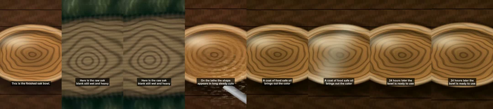

# Muse Code drives Briefcut

Muse Code is Meta's coding agent. These runs give it only Briefcut's MCP tools and a plain-language task. It reads the tool schemas, calls the tools in order, and checks each result before the next step.

## Run 2: a full edit, end to end

Recorded 2026-11-04 at 22:04 UTC on an Apple M5 Max.

- Agent: Muse Code 1.4.14 (1.4.14-R7309.1), headless `muse exec`, model `muse-spark-1.3` (standard mode, `--contributor-mode off`).
- MCP server: Briefcut's `vedit mcp` over stdio, with a scratch workspace and `VEDIT_META_MODE=standard`.
- Tools offered: only Briefcut's (`-c 'run.toolset=["mcp__briefcutstd__*"]'`).
- Task: [`20261104T220420Z-full-edit.prompt.txt`](20261104T220420Z-full-edit.prompt.txt). In short: check status, import the clip, make a 15-second short that opens on the strongest moment, wait, read the plan, render, read the receipts, verify, and report.
- Clip: `examples/demo/workshop.mp4`, the procedural demo clip (40.02 s, 1280x720, with audio).

Command (`BC_*` variables hold the FFmpeg path, the scratch workspace and `standard`):

```bash
muse exec --trust-workspace --approval-mode never --contributor-mode off --model muse-spark-1.3 \
  --reasoning-effort low --max-model-steps 40 \
  -c 'run.toolset=["mcp__briefcutstd__*"]' \
  -c 'mcpServers.briefcutstd={"mode": "optional", "transport": "stdio", "command": "uv", "args": ["run", "--project", "<repo>", "--no-dev", "--extra", "mcp", "--extra", "sam", "vedit", "mcp"], "env": {"VEDIT_FFMPEG": "${BC_FFMPEG}", "VEDIT_WORKSPACE": "${BC_WS}", "VEDIT_META_MODE": "${BC_MODE}"}}' \
  --json --prompt-file 20261104T220420Z-full-edit.prompt.txt
```

What happened, from [`20261104T220420Z-full-edit.jsonl`](20261104T220420Z-full-edit.jsonl). Paths are shortened to `$WORKSPACE`, `$REPO` and `~`; nothing else changed.

| Step | Tool Muse Code chose | Result |
|---|---|---|
| 1 | `briefcut_status` | Ready; Meta configured, available, mode `standard` |
| 2 | `briefcut_import_clip` | 5,357,476 bytes, 40.02 s, 1280x720, audio |
| 3 | `briefcut_create_story` | Project `8320c05c75b44822b3262f9491edf958` queued |
| 4 | `briefcut_wait` | Planned in 58 s (Meta Voice Transcribe, then Muse Spark) |
| 5 | `briefcut_timeline` | 4 moments, 14.093 s, 5 caption lines, title "From Fallen Oak to Finished Bowl" |
| 6 | `briefcut_render`, `briefcut_wait` | Rendered and export-verified in 4 s |
| 7 | `briefcut_receipts` | 5 of 5 checks passed |
| 8 | `briefcut_verify` | `ok: true`, evidence id `ev_92a62597…6ffb4`, the video and 12 records, nothing changed |

The moments Muse Spark chose, as Muse Code reported them:

1. 0.22 to 1.89 s: the finished bowl, the opening hook (score 0.81).
2. 8.20 to 11.18 s: the raw oak blank (0.88).
3. 16.38 to 19.02 s: turning on the lathe (0.94).
4. 32.30 to 39.10 s: oiling, and ready to use (0.81).

The delivered file, probed with ffprobe: 14.10 s, 1080x1920, 30 fps, BT.709, with audio. [Contact sheet](20261104T220420Z-full-edit-contact.jpg).



Cost:
- Briefcut's own Meta calls: $0.0345 (Muse Spark story $0.0325, Voice Transcribe $0.0020), from the project's `meta-calls.jsonl`, against a $0.40 cap.
- Muse Code's own model use: 9 calls to `muse-spark-1.3`, 297,686 input tokens (251,400 cached), 1,666 output and 267 reasoning tokens. At the uncached standard price that is at most $0.38; cached input is billed lower.

Wall time: about two minutes from the first tool call to the reply.

## Run 1: one import

Recorded 2026-11-04 at 18:33 UTC. Muse Code 1.4.14, model `muse-spark-1.3-contributor` (the account default then). Task: import `examples/demo/workshop.mp4` and report its size. Muse Code called `briefcut_import_clip`, and Briefcut probed the clip: 40.02 s, 1280x720, with audio. Log: [`20261104T183316Z-import-clip.jsonl`](20261104T183316Z-import-clip.jsonl). Usage: 2 model calls, 45,631 input tokens (22,641 cached), 160 output. The log names the contributor model although the command passed `--contributor-mode off`; run 2 sets `--model` to be sure.

## Setup

See [MUSE_CODE.md](../../MUSE_CODE.md) for the `~/.config/muse/settings.json` entry. Muse Code refuses literal values for a server's `env` on the command line; pass `${VAR}` references, as above. Never put the Meta key in `settings.json`: Briefcut finds it in the Keychain, Settings, `.env.local`, or the environment.
